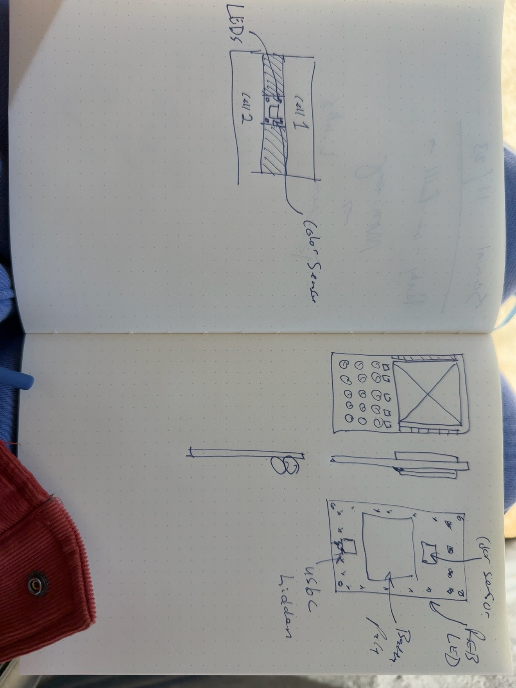
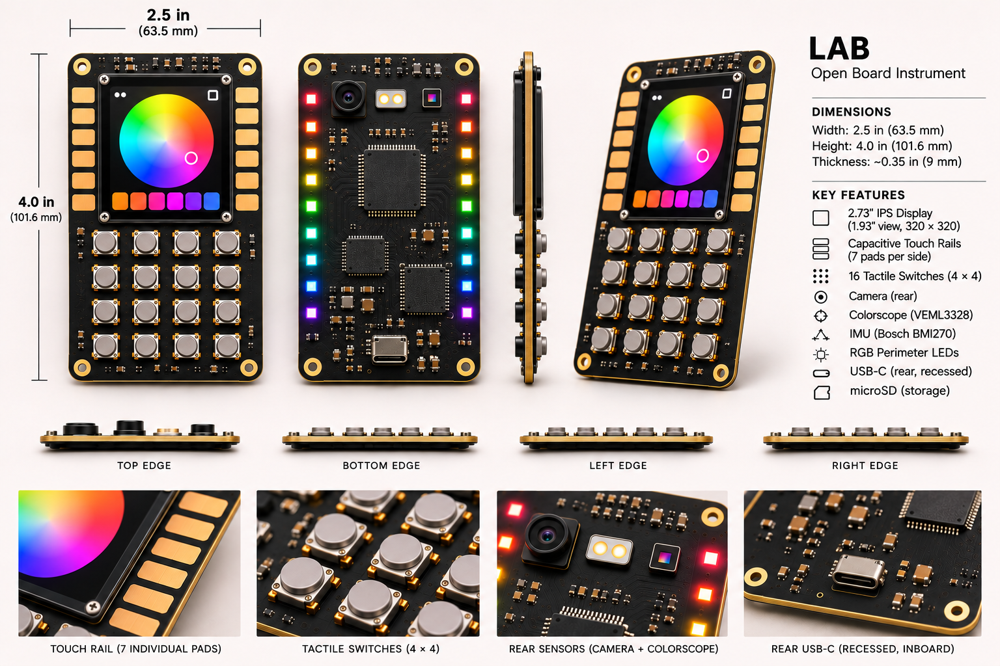

# Industrial design references

These two images document the November 26, 2026 industrial-design exploration. They are reference material, not mechanical drawings, validated PCB layouts, or production specifications.

## Original notebook sketch

The original sketch explores the exposed-board front, rear component placement, perimeter lighting, alternative battery configurations and colorscope chamber.

## Generated open-board concept

Visual study of the approximately 2.5 × 4 in (63.5 × 101.6 mm) exposed PCB instrument. The render explores the screen, copper touch electrodes, tactile switches, rear electronics and lighting. It contains illustrative inaccuracies and is not a finalized hardware layout. The intended design uses seven independent flush copper electrodes per side, sixteen bare tactile switches, twelve rear RGB LEDs, and a standard USB-C receptacle mounted on the rear surface and set back from the bottom edge, with the cable entering parallel to the PCB from the bottom. The board outline should remain uninterrupted, with no cutout for USB-C. Exact component placement, connector setback, battery mounting and mechanical fit are still open.

The [hardware architecture](hardware-architecture.md) and [BOM](bom.md) remain the source for component and engineering decisions.
