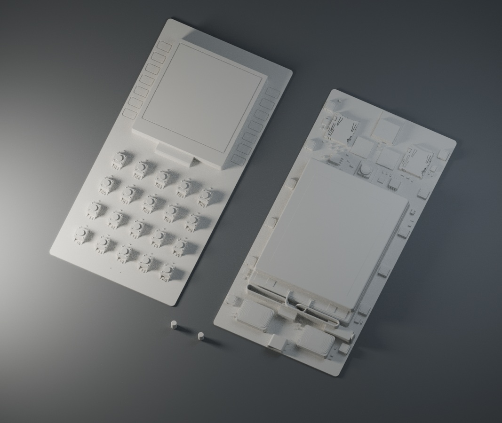

# LAB Pocket Rev 2 v6 fit sample

Open the [editable P1S plate](LAB-Pocket-R2-v6-P1S-r1.3mf) in Bambu Studio, or use the [sliced plate](LAB-Pocket-R2-v6-P1S-white-r1.gcode.3mf) with a P1S, a 0.4 mm nozzle, generic white PLA and a textured PEI plate. Print all four pieces on plate 1 at 100%. Bambu Studio estimates 1 h 50 min and 50.6 g. The profile uses 0.20 mm layers, three walls, 12% gyroid infill, 3 mm outer brims and supports off.

Remove the brims and dry-fit the two 3 mm pins in the blind sockets on the flat sides. Align the two board halves and press them together. A thin film of PLA-compatible glue at the seam makes the sample permanent.

The assembled digital sample measures **74 × 152 × 14.967 mm** with 2 mm board corners. Its 20 fixed keys, screen and rear battery surfaces come from the [v6 assembly](../blender/LAB-Pocket-R2-v6.blend). The print fills undercuts and uses single-colour relief for the key numbers and touch rails. The USB opening is a shallow impression for the hand model. The pins have 0.22 mm nominal radial clearance for a dry fit. The [assembled STL](LAB-Pocket-R2-v6-assembled-mm-r1.stl) gives the complete volume in millimetres.

The STL and each of the four plate objects passed checks for closed surfaces, outward winding, connectedness and dimensions. Bambu Studio sliced all four on one plate in 44 layers. The toolpaths include all 20 key tops. Dimensions and fit still need a physical print check.

