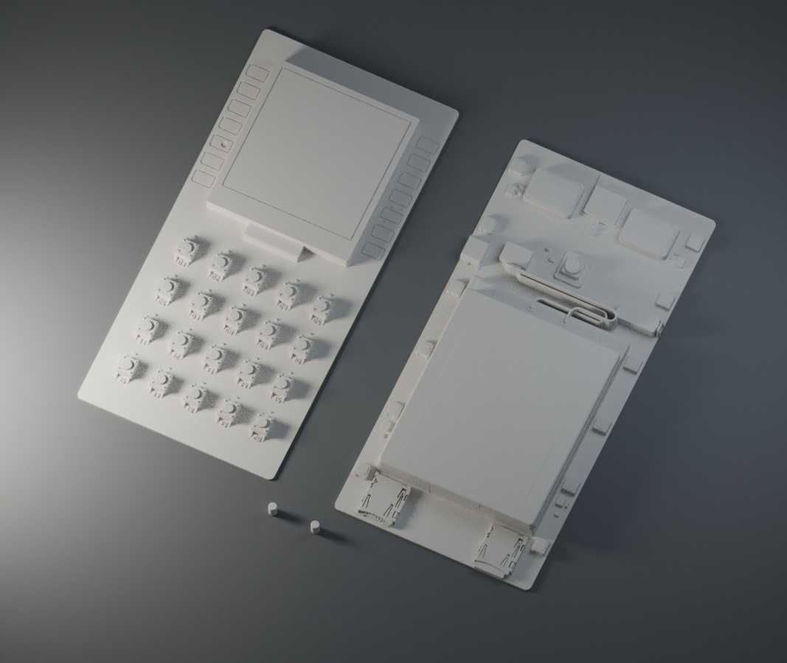

# LAB Pocket Rev 2 v8 fit sample

The editable Bambu Studio project places the front and rear of the device flat on the bed with two alignment pins. Use a P1S with a 0.4 mm nozzle, Generic PLA, a textured PEI plate and 100% scale. The white PLA slice uses 0.20 mm layers, three walls, 12% gyroid infill, 3 mm outer brims and supports off. Bambu Studio estimates 1 h 49 min and 50.19 g for all four pieces. [Editable plate](LAB-Pocket-R2-v8-P1S-r1.3mf) · [Sliced plate](LAB-Pocket-R2-v8-P1S-white-r1.gcode.3mf)

Remove the brims and dry-fit the two 3 mm pins in the blind sockets. Press the two flat faces together. The pins have 0.22 mm nominal radial clearance. A thin film of PLA-compatible glue at the seam makes the sample permanent.

The assembled hand model measures 74 × 152 × 14.967 mm. It includes the 20 fixed keys, side port mouths, top speakers, bottom sockets and flipped battery from the v8 assembly. Both side-port impressions are centered 45.300 mm below the top edge. These shallow impressions locate the openings by touch. The sample fills undercuts and uses raised or recessed details for the key numbers and screen border. The single-piece STL and each of the four plate meshes passed closed-volume and dimension checks. Bambu Studio sliced all four pieces in 44 layers. Dimensions and plug access still need a physical check on the hardware. [Assembled STL in millimetres](LAB-Pocket-R2-v8-assembled-mm-r1.stl) · [Blender model](../blender/LAB-Pocket-R2-v8.blend)

