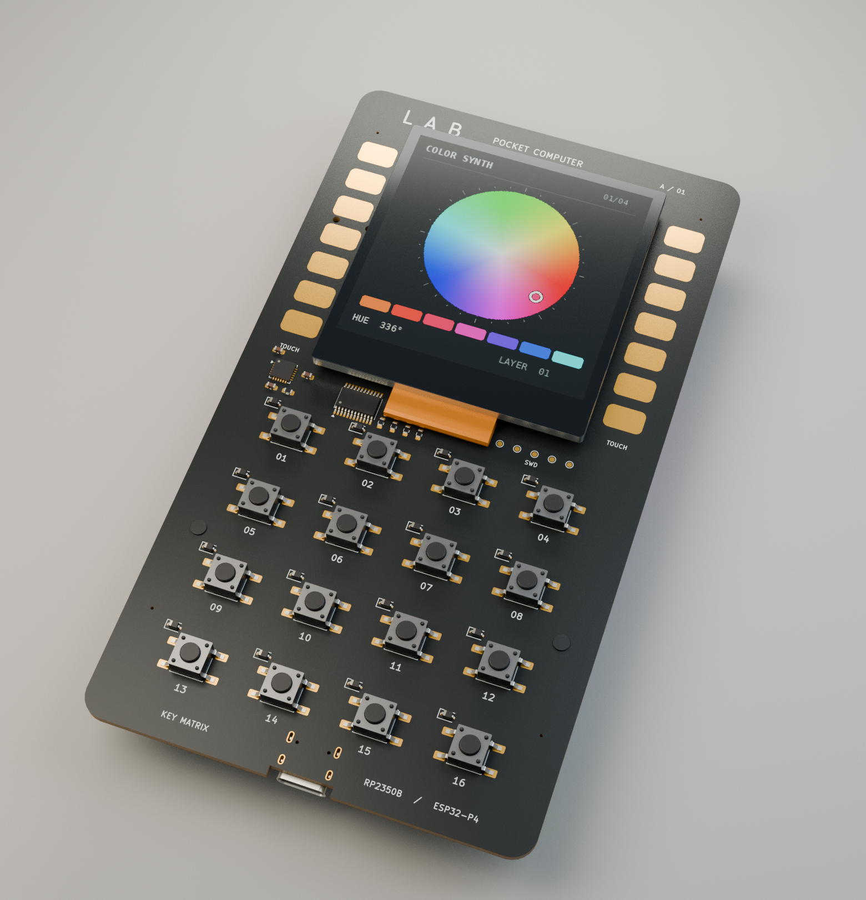

# LAB Pocket Computer · bare-board Rev A

Open [the KiCad project](kicad/LAB-Pocket.kicad_pro) in KiCad 10. The [nine-sheet schematic PDF](review/LAB-Pocket-schematics.pdf) and [1:1 mechanical drawing](review/LAB-Pocket-fit.pdf) can be reviewed without CAD software. Print the mechanical sheet on A3 at 100% and measure its 50 mm scale bar.



The front has the square LCD between two seven-pad gold touch rails and sixteen discrete tactile switches. The bare PCB has solid outside corners. On the rear, twelve RGB pixels flank a removable guard for the protected 4,800 mAh pouch. The camera, color sensor, connectors and speakers remain exposed. [Rear view](renders/rear.png) · [Guard removed](renders/service.png)

## Full-scale hand model

The [P1S print project](print/README.md) includes the front and rear halves, two alignment pins, a single-piece STL and editable geometry.

## Mechanical model

The [Blender 5 scene](blender/LAB-Pocket.blend) contains the actual [KiCad board mesh](blender/LAB-Pocket.glb), including copper, mask, silkscreen, holes and available library component models. The scene uses millimetres. Its three camera markers select the front, rear and open guard views on frames 1, 2 and 3. The display artwork and typeface are packed. The assembled device, guard, battery and studio have separate collections.

Dimensioned models supplement components without a usable STEP model. The LCD and support, flex, camera assembly, battery and harness, guard and feet, speakers, jack, battery header, microphones and several ICs have modeled envelopes. Markings, optical details and wire dressing represent the proposed appearance. The screen shows a proposed application. The modeled feet-to-screen depth is 20.55 mm. [Dimensional basis and allowances](fit.md)

## Electrical scope

| Sheet | Implemented in this revision |
| --- | --- |
| Host and user processors | Proposed ESP32-P4 GPIO map, C6 SPI connection, separate P4 and RP2350B boot flashes, RP reset and five SWD test pads |
| Keypad and touch | 4 × 4 diode-isolated matrix, I²C scanner, 14 discrete electrodes and capacitive controller |
| Panel and storage | 40-way panel interface, 18 RGB lines and two microSD sockets with separate chip selects and card detect |
| Sensors and audio | BMI270, VEML3328 and white emitter, four PDM microphones, CTIA jack and two speaker interfaces |
| Lighting | 3.3 V to 5 V data buffer and 12 chained rear-facing RGB packages |
| Power | USB-C sink CC loads, USB data and BQ24074 power path with charging inhibited |

**Engineering status.** The keypad matrix has local traces. The rest of the board is a placement study. KiCad 10.0.6 reports zero schematic/PCB parity errors, 388 unrouted connections and 108 physical rule violations. Of those violations, 104 are P4 land clearances under the project's 0.20 mm rule and four are hole-to-pad clearances at J1. The schematic ERC reports 161 findings, including unconnected pins and undriven rails. Keep these findings visible when continuing the design.

Power conversion, clock and reset support, complete decoupling, panel/backlight drive, camera carrier and supplies, audio codec and amplifier, antenna keepouts, and prototype bring-up remain open. The cable drawings and the temperature-sensing arrangement need verification before enabling battery charge. **This revision is for design review. Fabrication and power-up require further electrical and mechanical work.**

## Parts and verification

The [selection list](parts.csv) covers purchased electrical and mechanical parts in this revision. Its document column points to the 32 PDFs in the [datasheet archive](datasheets/index.csv). The index records publisher, source URL, page count and SHA-256. Family documents cover multiple resistor values, JST mating parts and connector variants. The guard, liner, display support, service studs and PCB copper features are custom geometry with no purchased part number yet. [Layout inspiration](reference/open-board-layout.png)

From this folder, run the following commands. On Ubuntu, the KiCad package exposes its Python bindings through the system interpreter.

```sh
/usr/bin/python3 check-fit.py
kicad-cli sch erc kicad/LAB-Pocket.kicad_sch -o /tmp/lab-erc.rpt
kicad-cli pcb drc --schematic-parity kicad/LAB-Pocket.kicad_pcb -o /tmp/lab-drc.rpt
```

