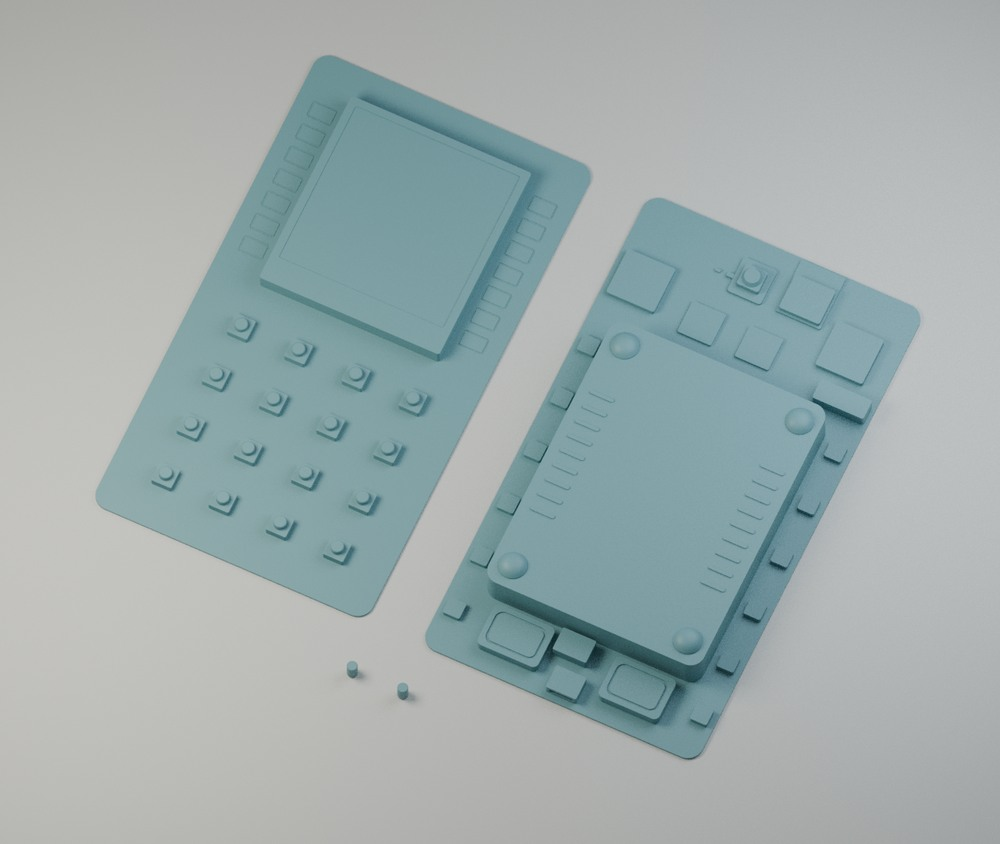

# Full-scale hand model for Bambu Lab P1S

Open [LAB-Pocket-P1S.3mf](LAB-Pocket-P1S.3mf) as a project in Bambu Studio. The plate contains the front, rear and two registration pins. Both halves print with their flat mating faces down. The finished sample measures **82 × 146 × 20.55 mm** and has solid outer corners. It lets you judge thumb reach, key spacing, screen size, rear grip and overall thickness. All controls and connectors are fixed shapes.



## Print and join

1. Select the P1S with a 0.4 mm nozzle. The project uses Generic PLA, a textured PEI plate, 0.20 mm layers, three walls, 12% gyroid infill, 3 mm outer brims and supports off. Match the filament and plate selections to your printer, keep scale at 100%, and slice plate 1.
2. Remove the brims, including the small rings around the pins. Insert a pin into each blind socket in the flat side of one half. Align the second half with the lens behind the display and USB-C below the keypad.
3. Dry-fit the halves. The edges should meet around the 1.6 mm board seam. For a permanent sample, apply a thin film of PLA-compatible adhesive to the mating faces and seat them together. Each pin is 3.00 × 5.00 mm. Each socket is 3.44 mm in diameter and 2.75 mm deep.

Bambu Studio 2.9.2 reopened this project and sliced plate 1 as four objects, 72 layers, approximately **1 h 43 min and 55.6 g of PLA**. These are slicer estimates. The printed pin fit, feel and dimensions still need a physical check. At 0.20 mm layers the nominal 20.55 mm depth rounds to approximately 20.4 mm in the preview before assembly and process tolerances.

## Geometry and source

The screen, 16 key centers and heights, 14 flush touch zones, rear optics, guard and feet follow the Rev A dimension study. The touch zones have shallow engraved outlines so they can be felt in a single-color print. The mock-up fills undercuts and simplifies component bodies for support-free printing. Its continuous bottom edge follows the merged industrial-design reference. The archived Rev A KiCad board has an 11.6 × 1.8 mm recess at USB-C. [Dimension study](../fit.md) · [Design references](../../../docs/design-references.md)

The [one-piece STL](LAB-Pocket-assembled-mm.stl) is a single closed solid in millimetres for examining the assembled volume or making your own cut. The P1S project contains the pre-split printable version. Both halves, both pins and the assembled STL were checked for connectivity, closed edges and outward winding.

The [Python source](make_model.py) rebuilds the assembled STL and a printer-independent 3MF with identical part placement. Run it with Python 3, NumPy and manifold3d 3.5.5.

```sh
python make_model.py ./build
```
